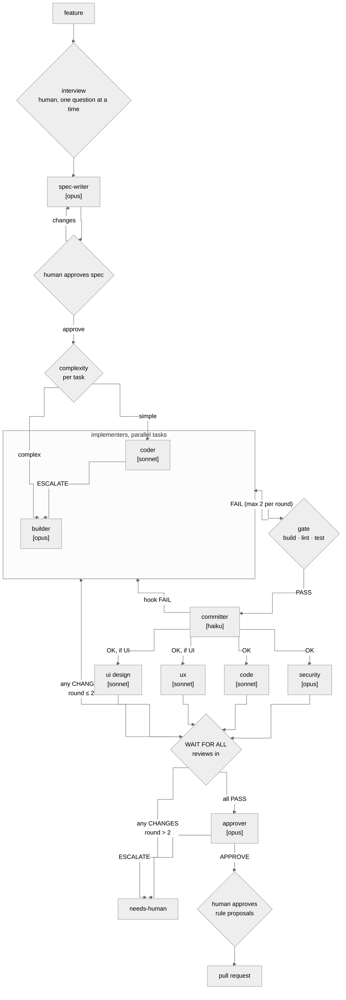

Build a simple, visual "software factory" using Claude Code skills, subagents, and markdown files. Keep it small: a viewer should understand the whole thing in a few minutes.

Packaged as the Claude Code plugin `devflow` (this folder). Install once, use in any repo.

## The orchestrator

The factory is one skill, `/devflow:factory`. Whichever Claude Code session runs it becomes the orchestrator: it runs the loop below, spawns every agent, runs the gate, and is the only writer of `factory/board.md`.

- One feature at a time, on its own branch: `feature/<id>` or `hotfix/<id>`, chosen by the spec-writer.
- Before the spec, the orchestrator interviews the human one question at a time until nothing is guessed; questions and answers go into the feature playbook.
- Every agent reads the project playbook (`factory/playbook.md`) first: conventions, patterns, reusable code, Definition of Done. It grows only through rule proposals the human approves.
- The human approves every spec and its done checklist (acceptance criteria + Definition of Done) before the build.
- Output is a pull request, never a direct merge to main.
- Re-running `/devflow:factory` resumes from the state in the board.

## The loop



## Contracts

| Step | Reads | Writes | Decides with |
|---|---|---|---|
| interview (orchestrator) | `feature.md`, playbook, codebase | feature `playbook.md` | asks until every criterion can be written without guessing |
| spec-writer | both playbooks, codebase | `spec.md`, done checklist | `kind`, tasks with owned files and `complexity`, `reviewers` list |
| coder / builder | `spec.md`, one task, reviews | code + tests for owned files (no commits) | coder → `ESCALATE` to builder if not simple |
| gate (orchestrator) | `config.md` commands | `gate-rN.md` | exit codes |
| committer | working tree, commit rules | Conventional Commits on `feature/<id>` or `hotfix/<id>` | forbidden files / hook fail → stop |
| reviewers | diff, `spec.md`, playbooks | `reviews/rN-<name>.md` with checklist table | `verdict: PASS \| CHANGES` (CHANGES only for blocking items) |
| approver | everything above | `decision.md` | every checklist item has evidence → `APPROVE`, else `ESCALATE` |
| rule proposals (orchestrator + human) | proposals from all agents | `factory/playbook.md` on the feature branch | human approves, edits or discards each one |

UX/UI review mode is set per project in `factory/config.md`: `none` (backend), `static` (read the diff, also for CLIs), `browser` (Playwright on the dev server).

## Files

```
plugin (this folder)                     target project
.claude-plugin/plugin.json               factory/config.md   commands, ui_review, max_rounds (committed)
.claude-plugin/marketplace.json          factory/board.md    one row per feature + log
.mcp.json            (Playwright)        factory/playbook.md project rules + DoD (committed)
skills/factory/SKILL.md (orchestrator)   factory/features/<id>/
agents/*.md          (9 agents)              feature.md, playbook.md, spec.md, rule-proposals.md,
                                             gate-rN.md, reviews/rN-*.md, decision.md
```
