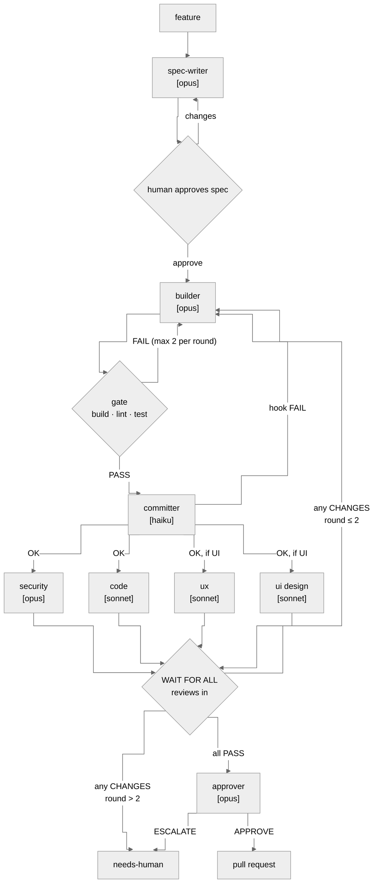

Build a simple, visual "software factory" using Claude Code skills, subagents, and markdown files. Keep it small: a viewer should understand the whole thing in a few minutes.

Packaged as the Claude Code plugin `devflow` (this folder). Install once, use in any repo.

## The orchestrator

The factory is one skill, `/devflow:factory`. Whichever Claude Code session runs it becomes the orchestrator: it runs the loop below, spawns every agent, runs the gate, and is the only writer of `factory/board.md`.

- One feature at a time, on branch `factory/<id>`.
- The human approves every spec before the build.
- Output is a pull request, never a direct merge to main.
- Re-running `/devflow:factory` resumes from the state in the board.

## The loop



## Contracts

| Step | Reads | Writes | Decides with |
|---|---|---|---|
| spec-writer | `feature.md`, codebase | `spec.md` | acceptance criteria + `reviewers` list |
| builder | `spec.md`, reviews | code + tests (no commits) | — |
| gate (orchestrator) | `config.md` commands | `gate-rN.md` | exit codes |
| committer | working tree, commit rules | Conventional Commits on `factory/<id>` | forbidden files / hook fail → stop |
| reviewers | diff + `spec.md` | `reviews/rN-<name>.md` | `verdict: PASS \| CHANGES` (CHANGES only for blocking items) |
| approver | everything above | `decision.md` | every criterion has evidence → `APPROVE`, else `ESCALATE` |

UX/UI review mode is set per project in `factory/config.md`: `none` (backend), `static` (read the diff, also for CLIs), `browser` (Playwright on the dev server).

## Files

```
plugin (this folder)                     target project
.claude-plugin/plugin.json               factory/config.md   commands, ui_review, max_rounds (committed)
.claude-plugin/marketplace.json          factory/board.md    one row per feature + log
.mcp.json            (Playwright)        factory/features/<id>/
skills/factory/SKILL.md (orchestrator)       feature.md, spec.md, gate-rN.md,
agents/*.md          (8 agents)              reviews/rN-*.md, decision.md
```
